# Directus: схема, автоматизация, соглашения

Этот документ описывает то, что нельзя почерпнуть, просто прочитав код репозитория — потому что оно живёт в базе Directus (`db.sch.com.ru`), а не в git. Документ обязательно читать перед тем, как:

- менять схему в БД;
- заводить Flow;
- разбираться, почему что-то на страницах, собираемых из данных Базы, выглядит так, а не иначе.

## Где используется БД

Данные из Базы используются на следующих страницах сайта:

- Главная: анонсы, дата новостей, дата обновления переводов;
- Новости;
- Лог;
- Дискография (также страницы отдельных дисков, кассет);
- Библиография (также страницы отдельных книг и страница сторонних изданий);
- Комментарии (СЗС);
- Каталог песен;
- Страницы песен: заголовок и первая строка песни, альбомы, на которых она издана, книги, в которые она вошла, закрыта ли страница от поисковиков;
- Каталог переводов (также страницы переводов и языковые разделы);
- Каталог концертов.

## Что такое Directus

[Directus](https://directus.io/) — это оболочка или интерфейс вокруг базы данных. Directus как оболочка даёт:

- API, который использует сайт при сборке для получения данных;
- веб-интерфейс базы данных, который используют редакторы и администраторы (Directus Studio);
- автоматизации в виде Flows;
- поля-псевдонимы для обратных связей и описание связей для веб-форм;
- уровень контроля доступа (политики, роли, пользователи).

## Инфраструктура

В качестве базы данных для Directus используется [PostgreSQL](https://www.postgresql.org/) (с 2026-08-19, первоначально был SQLite). Directus работает в контейнере на `db.sch.com.ru`.

## Доступ к данным

Доступ для приложения Hugo при сборке сайта осуществляется с помощью *публичного токена* в `config/_default/params.json` (не в git, см. `.gitignore`) пользователя Directus «Public read-only build token» с ролью `PublicReadAPI` политики `PublicRead` (с 2026-10-02). Токен опубликован в `config/_default/params.json.example` и README. Токен видит только записи со статусом `published` таблиц `events`, `perfs` — исполнения через их события `events` , `announces`, `log_entries`, `books`, `releases`, `recordings`, `translations` и не видит служебные поля у `events.comment`/`description`/`author_intro`/`user_created`/`user_updated` и `perfs.note`. Сайт, собранный с этим токеном, совпадает с опубликованным байт в байт (проверено 2026-10-02).

Если запросить поле, к которому у токена нет доступа, Directus ответит 403 на *весь* запрос, а сборка Hugo при этом не упадёт — партиал (*partial* — шаблон Hugo, запрашивающий данные из Directus) молча получит пустые данные. Поэтому в запросах партиалов `directus-*.html` нельзя запрашивать служебные поля. Права доступа Directus держит в кэше в памяти, поэтому после правки служебных таблиц `directus_*` проямо в Postgres администратору нужно делать `docker restart`.

## Directus Studio

**Directus Studio** — веб-интерфейс Directus, «админка» Базы: `https://db.sch.com.ru/admin`. Вход осуществляется под своим пользователем Directus. Что можно видеть и изменять, определяют роль и политики пользователя.

Основные разделы:

- **Content** — сами данные: списки записей коллекций и формы записей (песни, события с сет-листами, диски…). Здесь работают редакторы;
- **Settings → Data Model** — структура: коллекции, поля, их интерфейсы и связи;
- **Settings → Flows** — автоматизация (см. «Flows» ниже);
- **Settings → Access Policies** и **User Roles** — права досупа.
- **Settings → Extensions**. Это расширения Directus. Нектороые из них — собственные расширения проекта (см. «Собственные расширения» ниже). Это разработанные с Claude пользовательские интерфейсы полей, которые работают внутри веб-форм Directus Studio.

При сборке сайта Hugo не взаимодействует с Directus Studio — он читает те же данные напрямую через API Directus по токену (см. «Доступ к данным» выше).

**Studio и API: два способа входа, одни права.** Studio — сама клиент того же API: всё, что человек делает в Studio, уходит запросами к API. Разница — в том, как пользователь себя предъявляет:

- **в Studio** — e-mail и пароль на странице входа; Directus выдаёт сессию с короткоживущим ключом, который Studio сама продлевает, пока человек работает;
- **через API** (сборка сайта, скрипты, CI) — статический токен пользователя: строка, которую задают в профиле пользователя в Studio (поле Token) и передают в каждом запросе — параметром `access_token=…` в адресе или заголовком `Authorization: Bearer …`. Срока у статического токена нет: он действует, пока его не сменят или не очистят. Для программ заведены отдельные пользователи без пароля, только с токеном и своей ролью — например, пользователь сборки «Public read-only build token».

В обоих случаях действуют одни и те же роль и политики пользователя: Studio не даёт больше прав, чем API, и наоборот. Отсюда два следствия. 1. Чего не видит токен сборки (напр., статьи со статусом `draft`, служебные поля коллекций), того нет и на сайте, хотя редактор в Studio это может видеть. 2. Скрипту, читающему *структуру* базы для получения снимка `scripts/directus-schema.py --fetch` — понадобится токен администратора, потому что публичный токен не читает `/fields`, `/relations` и снимок схемы БД.

**Directus Studio vs Sveltia CMS**. Не путайте Directus Studio с редактором сайта в браузере (Sveltia CMS), `/admin/` на самом сайте: последний правит файлы в git-репозитории — тексты песен и страницы, — а не данные Базы.

## Коллекции

**Коллекция** — так Directus называет *таблицу базы данных:* однотипные записи (песни, события, исполнения) с одинаковым набором полей. Запись коллекции — строка таблицы, поле — её столбец. Коллекции видны в Directus Studio в разделе Content, их структура задаётся в Settings → Data Model.

Особый случай — поля-псевдонимы (тип `alias`, например `sets.entries` или `events.performers`): в таблице их нет, Directus собирает их из связей других коллекций (напр. *обратную сторону* «один ко многим» (O2M) или «многие ко многим» (M2M)).

Служебные коллекции самого Directus (`directus_users`, `directus_flows`, `directus_permissions`, `directus_files`…) — тоже таблицы этой базы, но не все относятся к данным сайта. `directus_files` используется для хранения фото к концертам, отображаемым на странице "Каталог концертов".

Не путать коллекции Directus с «коллекциями» Sveltia CMS в `static/admin/config.yml`: последние — это группы файлов в репозитории, а не таблицы БД. Да, Sveltia CMS свои группы файлов в репозитории тоже называет коллекциями. Постараемся последние заключать в документации в кавычки.

**Снимок схемы.** Структура базы (коллекции, поля, связи — без данных) лежит в `docs/directus-snapshot.json`. После каждого изменения модели в Directus администратор должен сделать: `DIRECTUS_ADMIN_TOKEN=… python3 scripts/directus-schema.py --fetch` — вручную запускаемый скрипт забирает свежий снимок, заменяет в нём точную версию Directus на мажорную и пересобирает диаграммы ниже. Снимок и `directus.md` надо коммитить вместе.

Зачем он нужен: из снимка строятся диаграммы этого документа (без доступа к базе), с помощью скрипта `/scripts/directus-schema.py`; в git он даёт историю модели — `git diff` показывает, какие поля и связи изменились; по нему видна структура тем, у кого нет прав администратора; командой `directus schema apply` по нему можно воссоздать структуру на другом экземпляре Directus. В снимке нет данных, поэтому резервной копией он не служит.

<!-- schema:legend -->
Чертежи между метками `<!-- schema:… -->` собирает скрипт `scripts/directus-schema.py` из снимка `docs/directus-snapshot.json` — их руками не править; текст вне меток скрипт не трогает. Подпись линии — поле, в котором хранится связь. В блоке таблицы каждая строка — поле: сначала тип Directus (`text`, `string`, `integer`, `boolean`…), затем имя поля, затем `PK` (первичный ключ) или `FK` (поле связи), если поле — ключ. `}o--||` — многие к одному, поле обязательно; `}o--o|` — многие к одному, поле может быть пустым; `}o--o{` — многие ко многим (через служебную таблицу). На схеме темы — только связи между её коллекциями; `works` и другие общие коллекции повторяются в нескольких темах.
<!-- /schema:legend -->

### Песня, исполнение, событие

База строится вокруг двух сущностей:

- `events` — концерта (или студийной сессии);
- `works` — песни (или стихотворения).

Связующим элементом между ними является известное исполнение, которому всегда присуще событие (даже если его время и обстоятельства неизвестны) и сам исполняемый опус. Сами исполнения образуют обширную коллекцию исполнений `perfs`.

<!-- schema:Песня, исполнение, событие -->
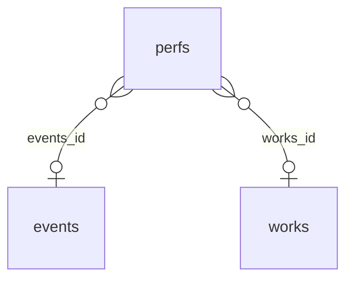
<!-- /schema:Песня, исполнение, событие -->

Остальные коллекции так или иначе примыкают либо к коллекции песен, либо к коллекции событий, о них — ниже: 

- [коллекции песни](#коллекции-песни);
- [коллекции события](#коллекции-события).

**Исполнения**

Исполнения (коллекция `perfs`) — центральная сущность, которую нельзя в большей степени отнести ни к песне, ни к событию.

`id` у исполнения имеет формат `<events_id>_<works_id>`. Поле `num` — это место в сет-листе события, 1, 2, 3… внутри каждого события (для студийных записей — условно). До 2026-11-14 у большей части исполнений номера были сквозными по всей базе, оставшимися от импорта CSV (до 13534); перенумерованы с сохранением порядка. При создании исполнений в Directus Studio по порядку `id` и `num` по умолчанию заполняется автоматически с помощью Flow «Auto perf id».

<!-- schema:Исполнения -->
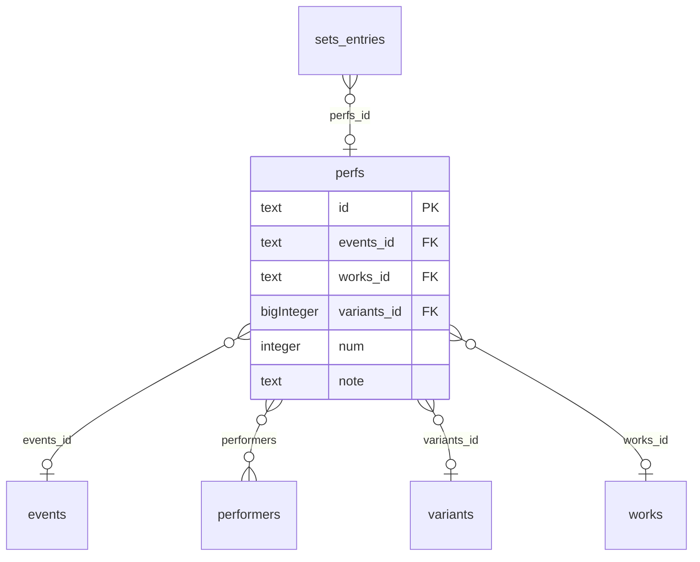
<!-- /schema:Исполнения -->

Связи:

| Коллекция | Поле | Что это |
|---|---|---|
| `events` | `perfs.events_id` | событие, на котором исполнено; обратная сторона — сет-лист события `events.songs_performed` |
| `works` | `perfs.works_id` | какая песня исполнена |
| `variants` | `perfs.variants_id` | какой вариант текста прозвучал (если отмечен) |
| `performers` | `perfs.performers` (многие ко многим) | участники исполнения, записанные явно (см. ниже) |
| `sets_entries` | `sets_entries.perfs_id` | на каких дисках, кассетах и в каких подборках это исполнение издано |

Остальные поля `perfs` — флажки исполнения (на чертеже не показаны):

- место в концерте (`is_first` — первая песня концерта, `is_last` — последняя песня концерта, `is_first_after_break` — первая песня после антракта, `is_last_before_break` — последняя перед антрактом, `is_bis` — исполнено на бис);
- участие других исполнителей:

    - `with_mls` — с Михаилом Стародубцевым;
    - `has_mls_voice` — поёт ли Стародубцев;
    - `plays_mls_guitar` — играет ли Стародубцев на гитаре;
    - `plays_mls_keyboards` — играет ли Стародубцев на клавишных;
    - `mls_instrument` — инструмент Стародубцева (не булево, текст; редко), например вид клавишных («рояль»); на весь концерт — `events.mls_instrument`;
    - `sings_mls_only` — исполняет только Стародубцев целиком (редко);
    - `is_pseudo_duet` — исполнение более одного голоса Щербаковым, даб голоса (для студийных записей; дабы гитары этим флажком, видимо, сочтены несущественными и не отмечаются);
    - `is_ensemble` — участие других исполнителей не в дуэте со Стародубцевым, а в ансамбле (редко);
    - `mks_no_voice` — Щербаков не поёт (редко; например, мелодийные композиции «Целого лета» второго издания);
    - `mks_no_guitar` — Щербаков не играет на гитаре (для концертных исполнений);

- другие особенности:

    - `is_premiere` — первое известное публичное исполнение;
    - `is_poem` — прочитано ли как стихотворение;
    - `take` — дубль, повтор попытки (булево, номера дубля не хранит; для студийных записей);
    - `sings_incomplete` — исполнено не до конца;
    - `sings_with_minus` — исполнено под минус (для концертных исполнений, очень редко);
    - `has_synth` — исполнено под синтезатор: аккомпанемент синтезирован, синтезатор работает как секвенсор (для студийных записей; живое исполнение под минус на концерте — `sings_with_minus`);

- `note` — свободный комментарий, замечание по исполнению (не авторское); публичный токен его не видит.

Явно записанные участники (`performers`) на 2026-10-18 есть у 5 исполнений из 13 616; остальные участники дуэтов пока не перенесены из старых текстовых заметок и `note`. Чужие и сторонние записи в `perfs` намеренно не пишутся — для них `recordings` (см. «Исполнители»): в `perfs` только исполнения М.Щ. по событиям, на них стоит статистика.

Пока что шаблон страницы мало использует эти данные, поля в базе почти не заполнены. Работа с исполнениями в Базе — отдельное направление. Могут быть добавлены другие поля, например, исполнена ли песня на распевке до концерта.

### Коллекции песни

к коллекциям события — [ниже](#коллекции-события).

**Песни**

<!-- schema:Песни -->
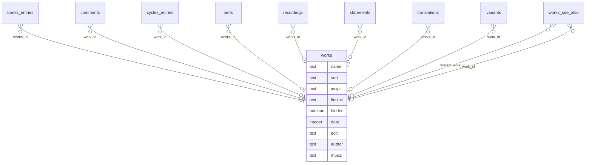
<!-- /schema:Песни -->

Песни (таблица `works`) — одна из двух основных сущностей Базы.

- Поле `id` — строка, совпадает с именем файла текста песни `content/texts/<год>/<id>.md`.
- У песни есть поле `name` с MD-форматированием, кавычками и тире. Поле `name` обязательно для всех песен с названиями. По конвенции — со строчной буквы, сайт сам делает заглавной первую. Кавычки «» — часть названия. Выделение слова — разметкой `*так*` (с 2026-11-02 вместо разрядки пробелами): на сайте курсив `<em>`, в `<title>`, поиске и атрибутах снимается. Пусто — у песни нет названия (152 из 560 на 2026-11-02): тогда на её странице «* * *», а в списках — `fincipit`.
- Поле `qualifier` (с 2026-11-02) — уточнение, различающее песни с одинаковым названием там, где нет разметки (`<title>`, поиск, редакторы в Directus): «Завтра, вчера, всегда: вчера»; заполнено у трёх песен «Завтра, вчера, всегда».
- Правило выбора названия одно для всех шаблонов — `layouts/partials/work-title.html`: `name` (`html` — с курсивом, для видимого текста; `plain` — без разметки, с «: `qualifier`»), иначе `fincipit`. Собственные расширения Directus (`setlist-editor`, `perf-picker`, `album-tracklist`) повторяют его в `workTitle()`.
- Поле `sort` важнее, чем может показаться. Хотя пользователь сайта его на страницах нигде не видит, оно используется при сборке сайта и в админке (Directus Studio):

    а) по нему происходит сортировка песен в каталоге песен и СЗС;
    б) оно служит для отображения человекочитаемого имени песни в Directus Studio;
    в) по нему в Directus Studio идёт сортировка в выпадающих списках песен при заполнении концертов и дисков.

То есть поле `sort` не только технический ключ сортировки, но и «рабочее имя» песни для редактора: оно заполнено у всех песен и уникально. Оно не должно содержать кавычек (открывающая кавычка делает сортировку невозможной) и разметки.

    - Порядок сортировки на сайте: цифры, кириллица, латиница.
    - «ё» как «е».
    - На сайте поиск по `sort` не идёт. Обычно это название с заглавной, у песен без названия — первая строка, которая в отдельных случаях бывает длиннее `fincipit`.
    - Соглашения: двузначные номера с ведущим нулём «Интермедия 01»…«Интермедия 16» — ведущий ноль нужен: кнопка «по названию» сравнивает числа по значению, а сборка (`sort` в Hugo) — как строки, и без нуля «Интермедия 10» встала бы перед «Интермедия 2»;
    - различители «Караван (с народным рефреном)», «На всей Земле 1»; латиница без диакритики «Deja».

- Поле `incipit` это первая строка песни без кавычек с многоточием в конце. Это `<meta name="description">` страницы песни; в каталоге — поиск у песен без названия.
- Поле `fincipit` это сокращённая первая строка. Используется на странице Каталога песен ради мобильных экранов: рядом с названием в скобках или вместо названия, ключ сортировки «по первым словам»; это же `<title>` песни без названия.
- Поле `hidden` регулирует, отображать ли песню в каталоге; скрывают, например, чужие песни.
- Поле `noindex` (с 2026-10-01) — страница песни получает `noindex` и не попадает в `sitemap.xml`; независимо от `hidden`.
- Поле `date` — год написания песни. Для неточных дат используем отрицательное значение. При построении адреса `texts/<год>/<id>.html` в шаблонах обязательно брать `math.Abs`, иначе получится путь со знаком «минус», не совпадающий с реальной папкой.
- Поле `edit` — год последней большой редакции песни (см. «Редакции песен» ниже).
- Поле `author` — автор слов; у песен Щербакова так и записано: «Щербаков».
- Поле `music` — автор музыки, так же; пусто — музыки нет (стихи) или автор музыки не указан.
- Поле `is_poem` — произведение целиком стихотворение без музыки; **не путать с `perfs.is_poem`** (стихи, прочитанные в отдельном исполнении).
- Поле `is_new` — метка «новое» у песни в каталоге песен; на 2026-11-03 не стоит ни у одной.
- Поля `is_popurri`, `description` и `date_created` сайт не читает. `date_created` Directus заполняет только у новых записей, у старых — `null`; дата «Каталога песен» в меню с 2026-10-18 берётся из файлов текстов (см. «Сторона Hugo» ниже).

На песню ссылаются другие коллекции; сама `works` ссылок не хранит, поле связи — у ссылающейся коллекции:

| Коллекция | Поле | Что это |
|---|---|---|
| `perfs` | `works_id` | исполнения песни на концертах и в студии |
| `variants` | `work_id` | варианты (словесные разночтения) текста |
| `books_entries` | `works_id` | запись песни (в смысле БД) в оглавлении книги |
| `comments` | `work_id` | комментарии «Словаря Заморских Слов» |
| `works_see_also` | `work_id`, `related_work_id` | «см. также»: комментарий к одной песне отсылает к другой |
| `cycles_entries` | `work_id` | вхождение песни в цикл |
| `translations` | `works_id` | переводы на другие языки |
| `recordings` | `works_id` | записи песни вне `perfs`: чужие исполнения, исполнения переводов, песни переизданий |
| `statements` | `work_id` (многие ко многим) | реплики, ответы на записки, высказывания, вступления к несостоявшимся исполнениям, относящиеся к песне |

Удалить песню — значит обнулить все эти ссылки (Directus ставит в них пусто); поэтому песню обычно не удаляют, а скрывают (`hidden`).

**Издания**

<!-- schema:Издания -->
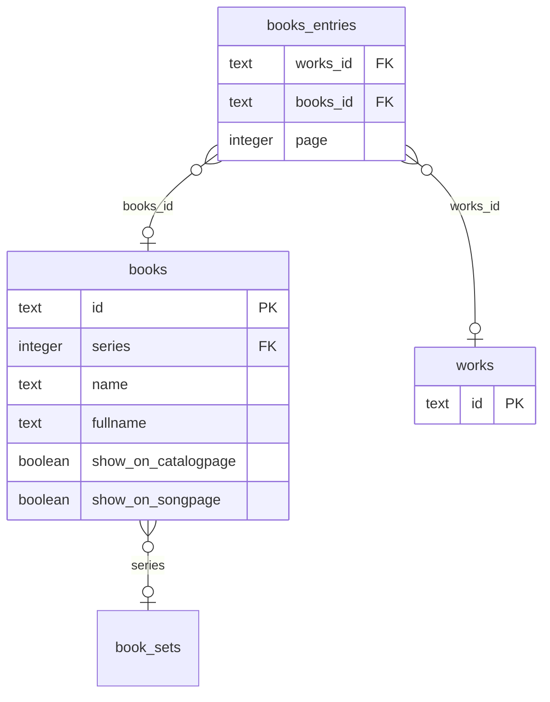
<!-- /schema:Издания -->

Песни `works` входят списком оглавления в книги `books` посредством M2M-связи через таблицу `books_entries`. Книги входят в свою очередь в многотомники и серии `book_sets` (Собрание песен, Ковчег неутомимый / После Ковчега).

**Комментарии**

<!-- schema:Комментарии -->
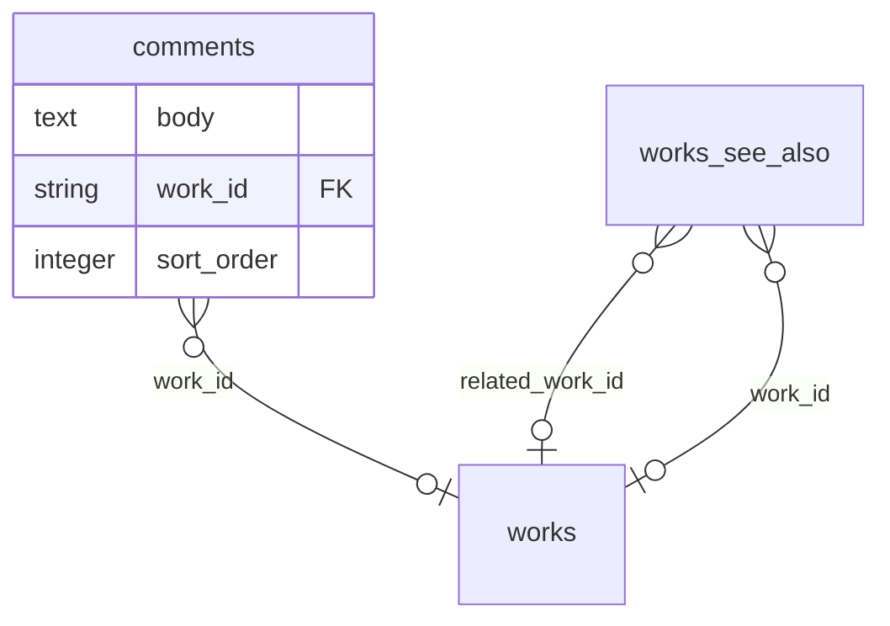
<!-- /schema:Комментарии -->

Для Комментариев (Словаря Заморских Слов) ведётся таблица `comments` где на каждую песню `works` имеются записи (на деле — одна запись на песню со всеми комментариями в поле `body`, но это не обязательно, а лишь от лени, потому что у каждого комментария могут быть имя автора, контакт автора, время добавления и выдержка). Для ссылок на комментарии к другой песне используется таблица `works_see_also`.

**Варианты**

<!-- schema:Варианты -->
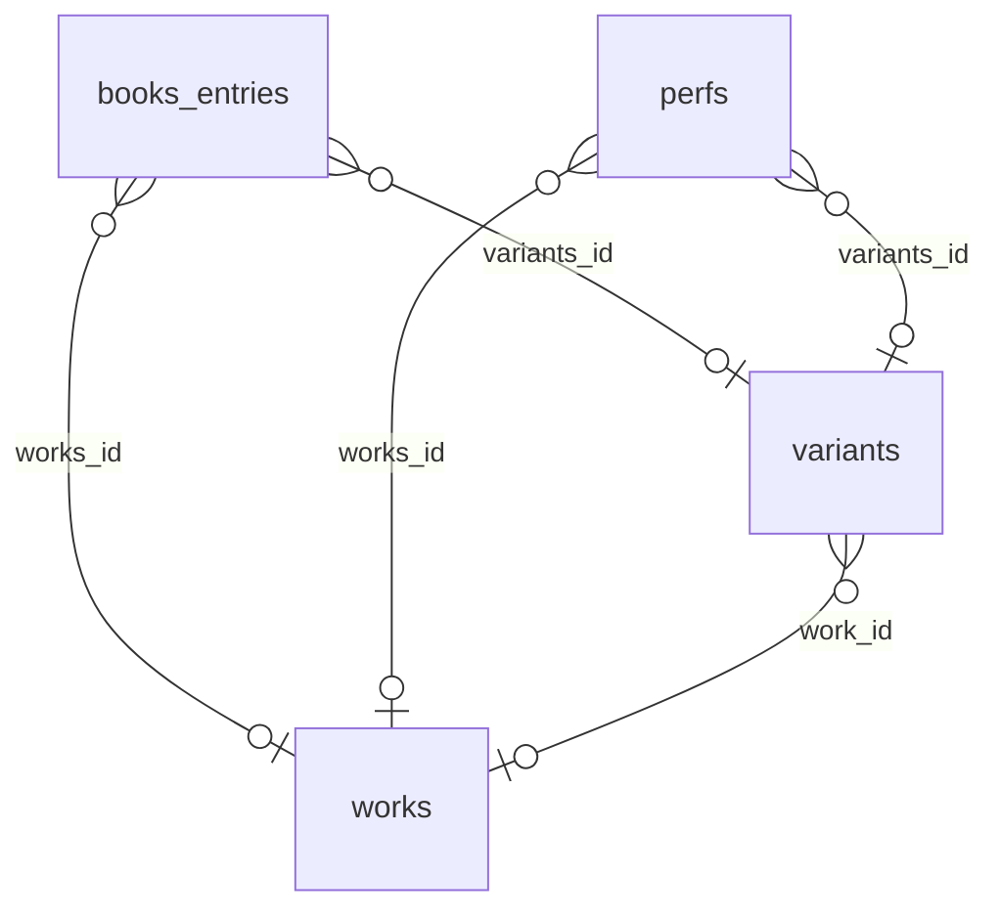
<!-- /schema:Варианты -->

Таблица `variants` (на будущее; возможно, избыточна) предполагается для фиксации мелких вариантов текста. Не имеет поля для полноценного текста песни, а только для описания варианта. Теоретически, может использоваться для хранения, какой вариант в каком издании зафиксирован, на каком событии был исполнен автором.

**Переводы**

<!-- schema:Переводы -->
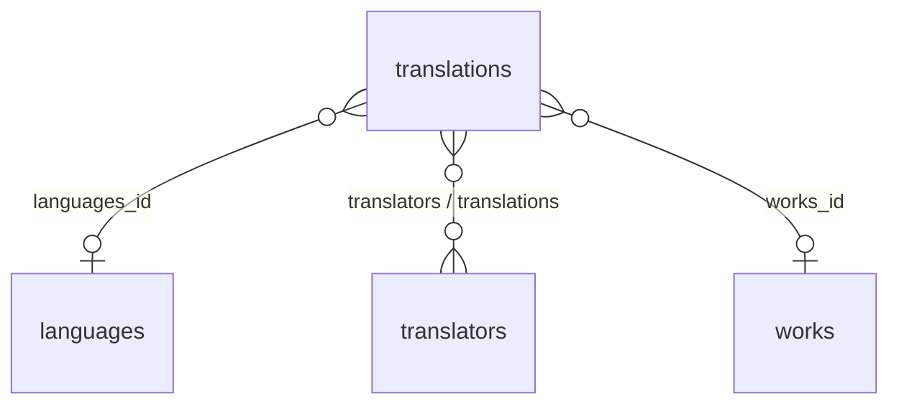
<!-- /schema:Переводы -->

Переводу присущ язык (`languages`), переводчик (`translators`) и сам переводимый опус (`works`). По соглашению `id` перевода должен быть в формате `<id песни>-<id переводчика>`.

**Циклы**

<!-- schema:Циклы -->
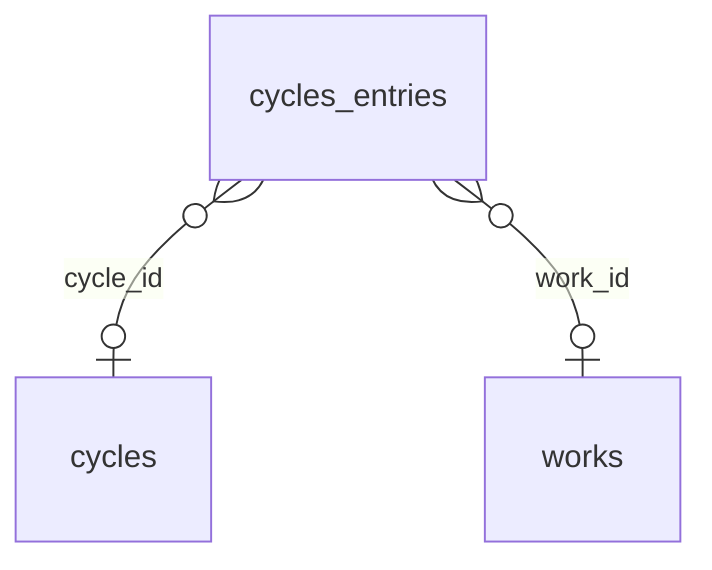
<!-- /schema:Циклы -->

Песня из `works`, теоретически, может входить в авторские циклы произведений `cycles`, о которых мало что известно, если не считать *Монологов странствующего рыцаря* 1981 года.

**Высказывания**

<!-- schema:Высказывания -->
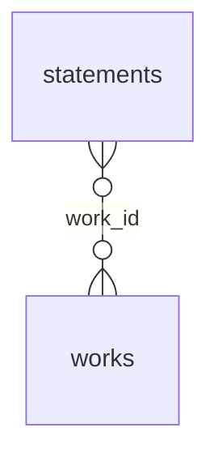
<!-- /schema:Высказывания -->

Эта коллекция может, теоретически, стать обширной, если посвятить изрядное количество сил, времени и упорства систематизации авторских высказываний о своих песнях и не только.

**Исполнители**

<!-- schema:Исполнители -->
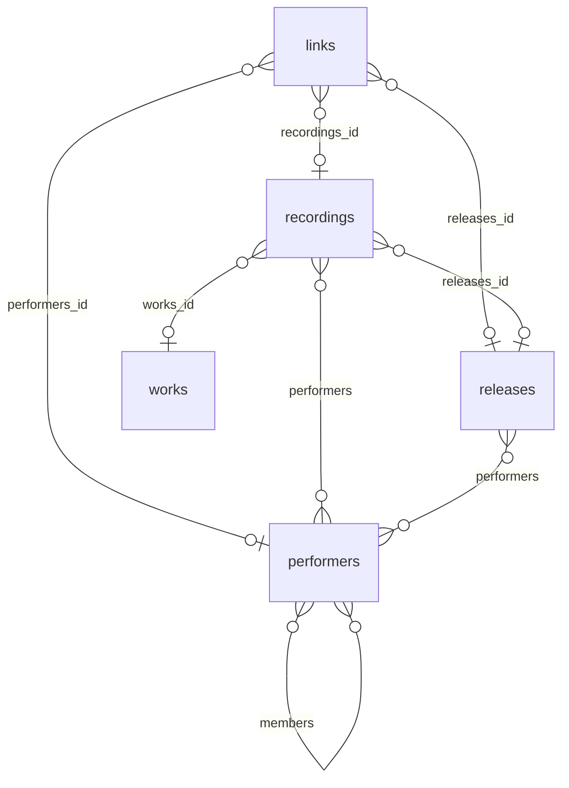
<!-- /schema:Исполнители -->

Кроме Михаила Стародубцева, исполнителями `performers` могут быть участники немногочисленных имевших место публичных авторских исполнений (такие исполнения считаются `is_ensemble`). 

Неавторских же исполнений можно при желании собрать множество. Исполнитель может состоять в исполнительском объединении (в прошлом или настоящем) — тогда у него будет связь (`members`) с объединением.

### Коллекции события

к коллекциям песни — [выше](#коллекции-песни).

**События**

<!-- schema:События -->
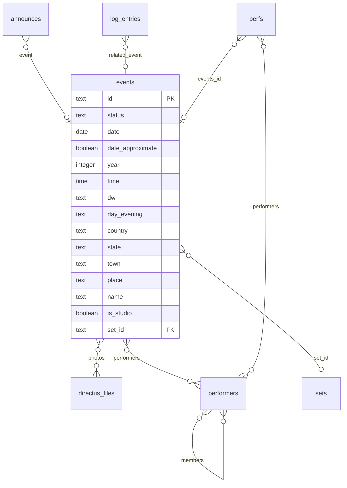
<!-- /schema:События -->

Событие (`events`) — концерт или студийная запись (`is_studio`). Поле `id` заполняется в формате `L<дата>` для концерта или `s<дата>` для студии (см. «Соглашения по именам») вручную редактором во время заполнения события либо автоматически с помощью Flow «Auto event id» в момент сохранения, если уже заполнена точная дата (для концертов). Также автоматически по `date` Flow «Auto year and dw»  проставляет `year` (год) и `dw` (день недели). Без выбранной точной даты `date` у `id` и `dw` остаётся пустое значение, `year` тогда надо заполнять вручную. Булево поле `date_approximate` отмечает, что дата приблизительна (для трудно датируемых событий): в списке концертов тогда вместо даты выводится только год (46 событий на 2026-10-18). Поле `day_evening` различает дневной и вечерний концерт одного дня. Для событий (в основном, концертов) в хранилище Directus загружаются фото, привязанные к событиям. Они отображаются в Каталоге концертов и не хранятся в репозитории. Загруженные изображения (по соглашению не более 3000px) лежат в каталоге-хранилище на жёстком диске сервера Directus, Directus для отображения создаёт копию до 2000px и превью "обложки" концерта, Hugo скачивает их при сборке в `photos/<id события>/` собранного сайта. В служебной таблице `directus_files` в полях `author` и `source` хранятся данные об авторе снимка и источнике, откуда снимки взяты.

На сайте в список концертов попадают только `status = published`, не студийные и уже прошедшие. Статусы — `published`/`draft`/`archived`/`cancelled`; `draft` — неопубликованное событие, публичный токен его не видит (до 2026-10-02 в `draft` по ошибке стояли 33 старые студийные записи, они переведены в `published`). Ещё не состоявшиеся концерты имеют статус `published` с датой в будущем: прошёл концерт или нет, различать строго по `date`, не по `status` (см. `directus-concerts.html` ниже).

Остальные поля `events`:
- `time` — время начала, выводится в анонсе.
- `name` — своя подпись события в списке концертов вместо даты (35 событий).
- `country` (страна), `state` (штат или регион), `town` (город), `place` (дом, зал, площадка).
- `is_home` — квартирник, домашний концерт.
- `with_mls` — концерт в дуэте с МЛС: пометка «дуэт» и фильтр «Дуэты» в списке концертов, «и Михаила Стародубцева» в анонсе.
- `plays_mls_keyboard` — МЛС на этом концерте играет на клавишах (в том числе вместе с гитарой); в списке концертов даёт «дуэт (клавиши)» вместо «дуэт (гитара)», только если `mls_instrument` пуст; не путать с `perfs.plays_mls_keyboards` — то же по отдельному исполнению.
- `mls_instrument` — инструменты МЛС на концерте, текстом, как в скобках старой страницы: «гитара», «клавиши», «рояль», «гитара, рояль», «гитара, металлофон»; в списке концертов выводится в пометке «дуэт (…)» вместо выведенного из `plays_mls_keyboard`. По отдельной песне — `perfs.mls_instrument`.
- `sort` — сайт не читает, список сортируется по `date`.
- `comment` (краткий комментарий), `description` (более развёрнутое описание), `author_intro` (авторское вступительное слово) — публичный токен их не видит.

Связи:

| Коллекция | Поле | Что это |
|---|---|---|
| `perfs` | `perfs.events_id` | исполнения на событии — его сет-лист; в форме события это поле-псевдоним `songs_performed` (ничего не хранит; редактор сет-листов, см. «Собственные расширения») |
| `performers` | `events.performers` (многие ко многим) | кто выступал на событии |
| `sets` | `events.set_id` | альбом или подборка, с которыми концерт совпадает полностью или частично |
| `announces` | `announces.event` | анонс предстоящего события; анонс без своего текста собирается из полей события |
| `log_entries` | `log_entries.related_event` | запись в Логе на сайте, относящаяся к событию |
| `directus_files` | `events.photos` (многие ко многим через `events_files`, порядок — `num`) | снимки события; первый — обложка концерта в каталоге, все вместе — галерея (см. «Файлы и пресеты») |

Линии между остальными коллекциями (`perfs`↔`performers`, `performers`↔`performers` через `members`) на этом чертеже оставлены: они показывают, что исполнителей можно указать и у события целиком, и у отдельного исполнения.


**Сверка со старой страницей концертов.** Старый список концертов (`lambda.mkshch.com/fans/utf/concerts.html`) всё ещё
ведётся, поэтому события и исполнения сверяются с ним скриптом `scripts/legacy-concerts-sync.py` (подробности — в его
шапке). Без ключей он только печатает отчёт публичным токеном: каких событий и исполнений нет в базе, где программы
расходятся, что не опознано. `--apply` дописывает недостающее (существующее не меняет), `--fix --apply` правит поля уже
имеющихся событий и исполнений по старой странице (первая/последняя песня, антракт, «недопел», соло, клавишные,
исполнители, пустой `events.mls_instrument` — из скобок «дуэт (…)»); оба — только с `DIRECTUS_ADMIN_TOKEN`, их запускает администратор. `--since ГГГГ` — с какого года
(по умолчанию 2024), `--only id,…` — только эти события. Ручные решения, которые старая страница не знает, —
в `scripts/legacy-concerts-sync.json` (сопоставления песен и неточных дат, исправления полей, лишние и недостающие
исполнения, порядок). Сверка завершена 2026-11-10: программы всех концертов совпадают; перед правкой концертов
вручную стоит прогнать отчёт. Соглашения, установленные при сверке:
- повтор песни в программе заводится, только если на старой странице он помечен «(недопел)» (`_2` в `id`);
- «???» на старой странице — исполнение без песни, `id` `<событие>_unknown`;
- «(Ю. Ким, М. Щербаков)» перед песней — `perfs.performers` (`JCK`, `MKS`); без `MKS` — ещё `mks_no_voice` и `mks_no_guitar`;
- страна до 1991 года — «СССР» (в списке концертов, как и «Россия», не выводится);
- событие с неточной датой — `id` `L<год>-A`, `-B`… или `L<год>-<месяц>-xx`, `date_approximate`; `date` — начало года
  (1 февраля), если в программе нет песен того же года или такая одна, иначе ближе к концу (1 августа); месяц известен — 1-е число;
- события, восстановленные по аудиозаписям и неизвестные старой странице (`L1988-B`, `L2001-02-17`, `L2001-10-22`,
  `L2006-12-02`), остаются — раздел `db_only` в JSON.

**Диски**

Точнее, сеты. Кассеты, альбомы, магнитофонные подборки...

<!-- schema:Диски -->
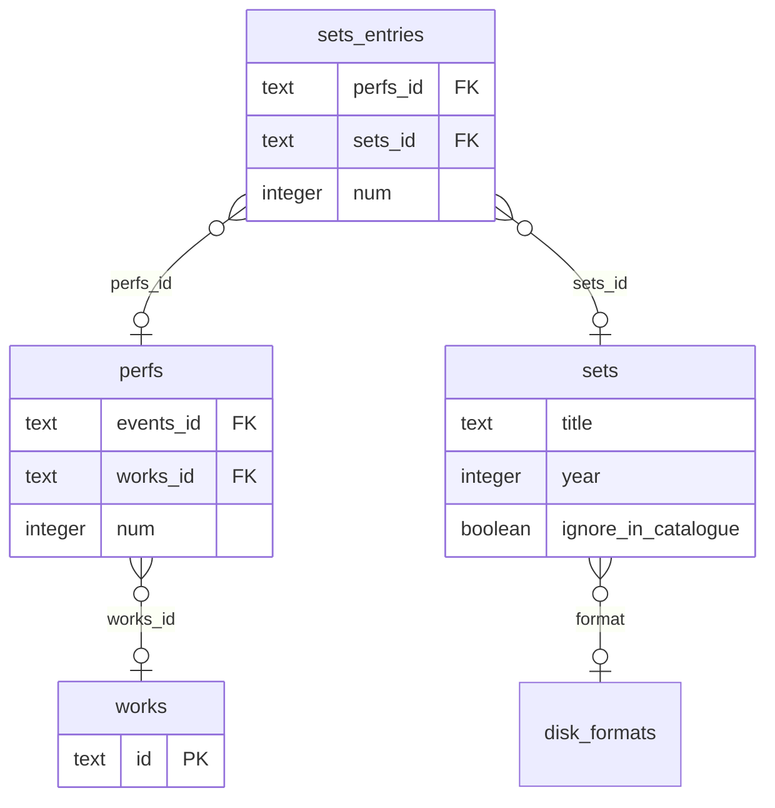
<!-- /schema:Диски -->

В диски (точнее, сеты, `sets`) авторских исполнений входят `perfs` (не `works`). Исполнения с сетами связаны через M2M таблицу `sets_entries`. 

Для неавторских проектов с песнями Щербакова в Базе другие сущности: `recordings` и `releases`.

**Лог**

Есть коллекция `log_entries` для событий сайта. Для записи в коллекции есть возможность связать её с событием (концертом). Теоретически, это может быть полезно, если событие сайта связано с концертом, но как это может быть использовано, пока неочевидно.

<!-- schema:Лог -->
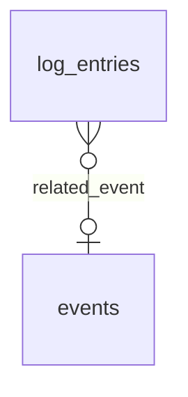
<!-- /schema:Лог -->

### Все коллекции: поля и связи

- **`works`** (коллекция песен и стихов) — поля описаны выше, в [коллекциях песни](#коллекции-песни) («Песни»).
- **`variants`** (коллекция вариантов текста) — `work_id` → `works`, `date`, `is_last_auth`, `url`; назначение коллекции — в «Вариантах» выше. Варианты текстов не путаем с полноценными редакциями текста (см. «Редакции песен»).
- **`perfs`** (коллекция исполнений) — поля описаны выше, в [ядре Базы](#песня-исполнение-событие) («Исполнения»).
- **`events`** (коллекция событий) — поля описаны выше, в [коллекциях события](#коллекции-события) («События»).
- **`directus_files`** (системная коллекция файлов Directus) — снимки событий. Сайт читает `id`, `title` (подпись в галерее, если в нём есть буквы), `width`, `height`; свои поля `author` (автор снимка) и `source` (откуда снимок взят). Сам файл лежит на диске сервера под именем `filename_disk` (uuid), при скачивании из Studio получает имя `filename_download`; `uploaded_by` — кто загрузил, на сайт не выводится. Хранилище, пресеты и права — в «Файлы и пресеты».
- **`events_files`** (связующая `events` ↔ `directus_files`) — `events_id`, `directus_files_id`, `num` (порядок снимков у события).
- **`sets`** (коллекция сетов исполнений):

    - `id` совпадает с именем значка альбома `assets/svg/cd/<id>.svg` в каталоге песен;
    - `is_album` — является ли сет опубликованным альбомом;
    - `title` — титульное название альбома;
    - `short_title` — сокращённое название альбома, используется для длинных названий вроде «Чужой музыки и не только, часть N» или «Минские встречи и не только»;
    - `abbrev` — сокращение (обычно двухбуквенное или однобуквенное) для альбома, на сайте не используется, может быть задействовано, теоретически, для генерации значков.
    - `year` — год публикации;
    - `format` — тип носителя/альбома, это внешний ключ (M2O) к коллекции `disk_formats`: cd/mp3/da/mc (аудио CD, MP3-диск, цифровой альбом, кассета);
    - `comment` — не служебное поле, выводится на странице диска или кассеты, содержит информацию о составе исполнителей, аранжировке, авторстве, звукорежиссёре, лейбле и проч.;
    - `album_img` — лицевая обложка;
    - `extra_images` — JSON-массив имён остальных изображений;

    *Примечание касательно изображений для дисков*. Полноразмерные изображения в базе не хранятся: соответствие того, какая картинка к какому диску относится, закодировано в имени файла. Поля `album_img` и `extra_images` указывают на превью `static/Images/<имя>.<ext>` (около 300 px по длинной стороне). Если рядом лежит `static/Images/<имя>-full.<ext>`, шаблон страницы `diskpage.html` или `tapepage.html` сам оборачивает превью в ссылку на полноразмерную версию, используя конструкцию `os.FileExists`. Отдельного поля для полноразмерных версий намеренно нет: параллельный массив URL пробовали — порядок двух массивов легко перепутать. С новым изображением поступать так: а) положить `<имя>-full.<ext>` в `static/Images/`, б) сделать превью `magick <имя>-full.<ext> -resize 300x300 <имя>.<ext>`, в) добавить альбому `<имя>.<ext>` в поле `extra_images` в Directus. На 2026-10-02 полноразмерные версии есть у всех изображений всех компакт-дисков; у кассет 01–08 — пока нет. Возможно, ради более «красивых» ссылок в мессенджерах и соцсетях стоит использовать не 300 px, а 1000 для превью (на будущее).

    - `ignore_in_catalogue` — скрывать альбом ради большей упорядоченности в каталоге песен, используется для первого издания Балаган 2 и Целое лето;
    - `is_studio`/`is_live` — студийный / концертный альбом: по ним `directus-sets.html` и `directus-sets-live.html` делят альбомы на странице «Диски» на «Студийные» и «Концертные», а `song-albums.html` различает их в блоке альбомов на странице песни;
    - `mkshchcom_url`, `spotify_url`, `apple_music_url`, `yandex_music_url` — ссылки на страницы альбомов на официальном сайте и музыкальных сервисах,
    - `description` — сайт не читает; на странице выводится `comment`, так сложилось по ошибке [СЗ];
    - `entries` — обратная связь к `sets_entries`, ничего не хранит. Подробнее — см. [пример](#псевдонимы-полей-для-обратной-связи-пример) ниже.

- **`sets_entries`** — join-таблица `perfs` ↔ `sets`:

    - `id` — строковый PK `<sets_id>_<num>_<perfs_id>`, собирается автоматически, если используется форма в коллекции `sets` (см. Flow «Auto set entry id»);
    - `perfs_id` — внешний ключ к коллекции исполнений;
    - `sets_id` — внешний ключ к коллекции сетов (дисков);
    - `num` (тип integer) — порядковый номер исполнения в сете;
    - `side` — сторона кассеты: `tapepage.html` делит по ней список песен; заполнено у 222 записей на 2026-10-18. Для винила поле тоже может быть актуальным, теоретически.

- **`announces`** — коллекция анонсов концерта или объявлений на сайте:

    - `event` (M2O → `events`, необязательное) — при создании можно создать событие прямо из формы анонса,
    - `text` — своя формулировка, чтобы не использовать шаблон анонса по умолчанию,
    - `link` — ссылка на страницу анонса площадки концерта (напр. сайта Гнезда Глухаря, страницу в facebook),
    - `publish_date`/`expiry_date` — окно видимости анонса,
    - `status` — публикуется только анонс со статусом `published`.

- **`comments`** — Коллекция комментариев к песням («Словарь заморских слов»), страница `fans/kom.html`:

    - `work_id` — внешний ключ → `works` (M2O, `SET NULL`),
    - `excerpt` — цитата из песни,
    - `body` — HTML: статья целиком,
    - `author_name` — имя автора статьи,
    - `author_contact` — mailto/URL,
    - `date_added`,
    - `legacy_anchor` (исходный `id` статьи на старом сайте),
    - `source_page` (`kom`/`kom2`),
    - `sort_order`.
    
    Перенесено полностью 2026-09-28: 287 записей, все 284 статьи старых `kom.html`/`kom2.html`.

    Модель допускает несколько записей на песню: шаблон выводит их по `sort_order`, каждую со своей подписью. Перенесённые статьи старого сайта сохранены так, что одной статье «Словаря» соответствовует одна запись коллекции (у 160 записей внутри `body` по несколько датированных заметок): надёжно разделить заметки внутри статьи нельзя, подписи авторов с датой и `mailto:` лежат в `body`, как на старом сайте. Тем не менее, новые заметки можно добавлять отдельными записями к той же песне, задав `sort_order` вручную. Поля заметки (`author_name`, `author_contact`, `date_added`) заполнены лишь у немногих вручную разобранных записей: «Болеро» 1 и 2 (одна старая статья на две песни), `aprel1986`/`kladbisc1986` (заметка на шесть песен, разнесена по песням), «Моя работа» (`mojarabo`, связь с `japomnju`). Если поля заполнены, шаблон выведет в конце «(Автор, ДД.ММ.ГГГГ)», автор — ссылкой при наличии `author_contact`.

    Интерфейс поля `body` в Directus — `input-code`, не WYSIWYG — намеренно. TinyMCE при сохранении из визуального режима выбрасывает незнакомые классы (`entry-date`, `editor-aside`), и первое же сохранение необратимо портит текст. Не переключать: TinyMCE переписывает HTML на свой лад, и даже с `extended_valid_elements` разметка по правилам ниже не сохранится.

    **Правила разметки текстов заметок:**

    - кавычки «ёлочки» → „лапки“ → ‘одиночные’ по глубине вложенности;
    - тире между словами — `&nbsp;&mdash;`,
    - диапазоны чисел и лет — `&ndash;`;
    - разделитель строк стиха внутри строки — `&nbsp;// `;
    - курсив `<i>` — только слова самого автора (цитаты из песни, её варианты, автоцитаты), чужие цитаты и названия — без выделения, многострочные же ужие цитаты — `<blockquote>`, эмфаза — `<em>`;
    - `<dfn>` — объясняемое слово в начале абзаца в словарной форме;
    - дата заметки — `<span class="entry-date">` (красная);
    - реплика редактора — отдельным абзацем с подписью «— Ред.»;
    - латинские двойники букв в русских словах — кириллица;
    - ссылки на зеркала старого сайта — внутренние. Стили — `assets/css/kom.css` (`.reader-quote` там больше не используется).

    Для приведения текста новой заметки к этим правилам можно использовать скрипт `scripts/comments-markup/normalize.py` (см. README там же).

- **`works_see_also`**:

    - `id`,
    - `work_id` → `works` (статья-источник),
    - `related_work_id` → `works` (статья-цель).
    
    Хранится только прямое направление. 24 пары на 2026-10-03. Шаблон добавляет в конец карточки источника «См. также комментарий к «Название».», как на старом сайте, — только если у песни-цели есть своя карточка (комментарии), иначе ссылка вела бы в никуда.

- **`performers`** (Исполнители):

    - `id` (латиницей; у давних — сокращения),
    - `name` (как выводится на сайте: «Ю. Ким», «Лидия Чебоксарова», «Трио „БрюТ“»),
    - `fullname` («Фамилия, Имя» — для сортировки),
    - `kind` (`person`/`group`/`ai` — нейросеть, исполнитель ИИ-кавера; `ai` пока не встречается),
    - `members` (M2M на саму себя через `performers_members`: `performers_id` — коллектив, `related_performers_id` — участник, `num`),
    - `links`.
    
    Кроме `MKS`, `MLS` (см. глоссарий в README) и `JCK` (Ю. Ким), с 2026-10-03 — исполнители сторонних изданий (15 записей). `id` задуман как будущий адрес страницы исполнителя, если появится такой раздел.

- **`releases`** — Сторонние издания, страница `Disks/other.html`, 2026-10-03:

    - `id` (латиницей, он же якорь на странице),
    - `status`,
    - `kind`:

        - `cover` — чужие исполнения,
        - `reissue` — переиздание авторских записей,
        - `participation` — проект с участием М. Щ.;

        это три раздела страницы, их заголовки и якоря — в front matter `content/Disks/other.md`,

    - `title` (без кавычек, «ёлочки» ставит шаблон),
    - `subtitle`,
    - `publisher` — лейбл,
    - `year` — год выпуска,
    - `sets_id` → `sets` — у переиздания с тем же составом, что у набора: все три «Российских барда» → `ozon`; заголовок ведёт на страницу набора,
    - `cover_img` и `extra_images` — как у `sets`: путь от `static/Images/`, сейчас `OTHER/<имя>`; `-full` подхватывается так же,
    - `comment` — HTML; в нём же сохранены HTML-комментарии старой страницы,
    - `performers` — M2M через `releases_performers`: `num`, `role`. Участник *без* `role` — исполнитель/автор издания (у переизданий — `MKS`, на странице не выводится); *с* `role` — участие («М. Щербаков: аккомпанемент (гитара)»).

- **`recordings`** (Записи вне `perfs`):
    - `id` (число),
    - `status`,
    - `works_id` → `works`,
    - `title` — если песни нет в `works`, как у песен Ю. Кима, или на издании она названа иначе: «Юго-Восток» = `sezondoz`, «Норд-вест» = `baltijsk`,
    - `releases_id` + `num` (место на издании),
    - `year`,
    - `lang` — код языка; пусто — русский оригинал,
    - `note` — HTML: «муз. А.&nbsp;Крючков»,
    - `performers` — M2M через `recordings_performers`: `num`, `role`; пусто — исполнители издания,
    - `links`,
    - `translations_id` → `translations` — запись перевода; страница перевода выводит её в «Исполнениях», `SET NULL` при удалении перевода. О том, почему не в `perfs` — см. «Исполнения» выше.

- **`languages`** — Языки переводов:
    - `id` (код ISO 639-1: `en`, `de`, `eo`, `he`, `uk`, `fr`; он же папка `content/<id>/` и начало адреса страницы перевода),
    - `name_ru` («английский»),
    - `name_native` (самоназвание: English, עברית),
    - `dir` (`rtl` у иврита),
    - `sort`.
    
    Для языка следует различать:

    - переводы песен на язык. Перевод песни, как и песня, имеет страницу с текстом (в случае нескольких переводов несколько страниц) и запись в базе данных в `translations`;
    - остальной контент сайта, переведённый на язык (либо изначально на иностранном языке), страницы которого записей в БД не имеют.

    На момент осуществления концепции было решено образовать языковые заглавные страницы для языков, имеющих хотя бы один перевод на сайте. Чтобы образовать языковую страницу, нужно создать записи для языка в БД, создать директории с front matter настроек, добавить две строки в конфиге Sveltia CMS, добавить язык во Flow. Для этого следует:

    - создать запись здесь, в `languages`.
    - создать папку для контента — `content/<id>/` и страницу настроек `<id>-index.md` в ней (см. [docs/frontmatter.ru.md](frontmatter.ru.md)), правило cascade` в `hugo.json`,
    - страницы языка в «коллекции» Sveltia CMS «Страницы языков» задаются в `static/admin/config.yml` (переводы коллекция «Переводы» подхватывает сама, отому что «переводы» — папка второго уровня);
    - добавить язык в кортеж константы langs в скрипте Flow «Create text file for new song or translation».

    
- **`translators`** — коллекция Переводчики:

    - `id` (латиницей, напр. `wolfson`; этот `id` всегда входит в имя файла страницы перевода),
    - `name_ru` (кириллицей),
    - `name_lat`,
    - `name_native` (на языке переводов, если отличается, — так имя выводится на страницах раздела),
    - `description` (HTML; если заполнено — у переводчика будет своя страница, последнее ни для одного переводчика пока не сделано),
    - `links` (внешние ссылки, владелец `translators_id`).

- **`translations`** — переводы песен, с 2026-10-03; 89 записей:

    - `id` (= имя файла `content/<язык>/<id>.md`: `<id песни>-<id первого переводчика>`),
    - `status`,
    - `works_id` → `works` (оригинал),
    - `languages_id` → `languages`,
    - `title` (название перевода; пусто — «* * *»),
    - `incipit` (первая строка),
    - `year`,
    - `is_new` (метка «new» в каталоге переводов),
    - `note` (HTML-приписка к заголовку: «(with a folk refrain)»),
    - `source` (где опубликован: URL или текст),
    - `translators` (M2M через `translations_translators`: `num` — порядок, первым должен следовать переводчик, который имеет свой `id` в адресе страницы перевода),
    - `recordings` (обратная связь от `recordings.translations_id`),
    - `date_created`.
    
    Текст перевода — в файле, не в базе (как у песен). Каталог `translations.html`, списки и страницы переводов собирает `layouts/partials/translations-data.html` из одного запроса `directus-translations.html`.

- **`links`** (Внешние ссылки):
    - `url`,
    - `label`,
    - `kind`:

        - `official` — у издания оборачивает заголовок, у исполнителя — имя;
        - `tracklist`,
        - `listen`,
        - `shop`,
        - `article` — выводятся строкой ссылок;

    - `num`,
    - и *ровно один* владелец:

        - `releases_id`,
        - `recordings_id`,
        - `performers_id` или `translators_id` (проверка `links_one_owner` в Postgres; при удалении владельца ссылки удаляются).
        
        Для создания нового владельца (напр., `books`, `events`…) потребуется создать ещё одно поле, и исправить проверки `links_one_owner` и списка `owners` в скрипте Flow «Validate link has one owner» (см. «Flows»).

- **`disk_formats`** (Форматы носителей, 4 записи):

    - `id` (латиницей, он же часть CSS-класса значка: `cd`, `mp3`, `da`, `mc`),
    - `short` (подпись значка в каталоге: CD, MP3, DA, Cass),
    - `full` (полная подпись: Audio CD, Digital album, Audio cassette, — это будет показываться во всплывающей подсказке десктопной версии каталога песен при наведении на значок, а также это выводится на странице альбома),
    - `sort` (порядок групп в каталоге),
    - `path` (раздел сайта со страницами наборов этого формата: `Disks` или `Tapes`, регистр важен — по этому пути разделяются диски и кассеты на сайте). На неё ссылается `sets.format`. Это поле читает партиал `directus-disk-formats.html`.

- **`books`** (Книги, 14 записей):

    - `id` (он же `params.id` страницы `content/Books/<id>.md` и запасное имя обложки `Images/bkp/<id>.jpg`),
    - `status` (публичный токен видит только `published`),
    - `sort`,
    - `name` (краткое имя),
    - `fullname`,
    - `publisher` (издательство). Кстати, издательство Владимира Палта в *списке источников* по законам библиографии, возможно, лучше называть в именительном падеже, без слова *издательство*: «В. Палт»,
    - `year` (строка),
    - `pages` (количество страниц),
    - `isbn`,
    - `bibliography` (библиографическая запись, то есть что-то специфическое для каталогов, номера, видимо),
    - `annotation` (аннотация или описание),
    - `photo` (файл обложки),
    - `series` → `book_sets` (в какой серии состоит),
    - `range_years` (годы песен в книге — выводятся рядом с книгой на странице песни),
    - `show_on_songpage` (показывать ли книгу в блоке изданий на странице песни),
    - `show_on_catalogpage` (отображать ли в каталоге песен (значок книги)),
    - `catalog_icon` (CSS-класс значка в спрайте `schsprite`; пусто — класс = `id`; у книг серии с одним значком на все книги в строке песни выведется один значок).

    За страницу «Книги» и страницы книг отвечают партиалы `directus-books-list.html`, `books-index.html`, `bookpage.html`.

- **`book_sets`** — серии книг, сейчас в ней 2 записи: «Собрание песен», «Ковчег неутомимый и После Ковчега»:

    - `id` (число),
    - `name`,
    - `description`,
    - `sort` — группировка на странице «Книги».

- **`books_entries`** (Песни в книгах, 1071 запись):

    - `works_id` → `works`,
    - `books_id` → `books`,
    - `variants_id` → `variants`,
    - `page` (страница),
    - `num` (порядковый номер в содержании, если страниц нет или порядок с ними не совпадает),
    - `section` (раздел содержания, напр., «Песни безумца»; пусто, если разделов нет).
    
    Коллекцию в части содержания страниц книг и значков книг в каталоге читает партиал `directus-books.html`, в части блока изданий на странице песни — партиал `song-data.html`.

- **`cycles`** — циклы песен, сейчас 1 запись: `monologi`, скрыт намеренно, см. [showcase-and-club.md](showcase-and-club.md) §7:

    - `id` (он же `params.id` страницы `content/Cycles/<id>.md`),
    - `title`,
    - `comment`.

    Коллекцию читает партиал `directus-cycle-by-id.html`.

- **`cycles_entries`** (Песни цикла, сейчас 25 записей):

    - `id`,
    - `cycle_id` → `cycles`,
    - `work_id` → `works`,
    - `number` (порядок в цикле),
    - `page_id` (необязательно: другая редакция или страница — например, архивная с суффиксом `0` — если не совпадает с песней `work_id`).

    Коллекцию читает партиал `directus-cycle-entries.html`, страницу для циклов строит шаблон `cycle.html`.

- **`log_entries`** (Записи «Лога», 2 записи на 2026-10-18):

    - `status` (только `published` видны),
    - `sort`,
    - `date` (дата записи на сайте),
    - `text` (Markdown),
    - `related_event` → `events` (дата, город и место события выводятся рядом),
    - служебные `user_created`/`date_created`/`user_updated`/`date_updated`.
    
    Шаблон `log.html` выводит записи из базы по годам, а под ними — прежнюю хронику из тела `content/log.md` (она пока не перенесена в базу, нет ничего более постоянного, чем временное).

- **`statements`** — коллекция высказываний: реплики, ответы на записки, высказывания, вступления к несостоявшимся исполнениям (или состоявшимся) — заготовка: пока только `id` и M2M с песнями `work_id` через `statements_works` (`statements_id`, `works_id`); записей нет, сайт её не читает.

- **Служебные таблицы связей «многие ко многим»** — Directus создаёт их сам, когда заводят поле M2M; суффикс-число в имени он добавил в тех случаях, когда имя коллекции было занято предыдущей (неудачной) попыткой. Править их напрямую не нужно, удалять нельзя: в них хранятся сами связи.

    - коллекция `perfs_performers_1` (`perfs_id`, `performers_id`) — поле `perfs.performers`, участники исполнения;
    - коллекция `events_performers_3` (`events_id`, `performers_id`) — поле `events.performers`, участники события; сайт его пока не выводит;
    - коллекция `statements_works` — см. `statements`;
    - коллекции `performers_members`, `releases_performers`, `recordings_performers`, `translations_translators` — с порядковым номером `num` (у `releases_performers` и `recordings_performers` ещё и `role`); описаны у своих коллекций выше.

- **Имена полей связей:** новые поля:

    - `<коллекция>_id` (`releases_id`, `works_id`, `sets_id`), вторая связь на ту же таблицу — с приставкой `related_`. Так Directus сам называет поля связей «многие ко многим», и так названо большинство старых (`perfs.works_id`, `sets_entries.sets_id`). Старые исключения (`comments.work_id`, `variants.work_id`, `cycles_entries.work_id`/`cycle_id`, `events.set_id`, `works_see_also.*`) пока не переименованы: правка ключа затрагивает шаблоны, Flow и расширения, а ошибка тихо даёт пустые данные.

## Роли и права

В Directus 11 права лежат в **политиках** (Access Policies): политика — набор прав на коллекции. **Роль** (User Roles) — именованный набор политик; пользователю назначают роль, а при необходимости — и отдельные политики прямо в его карточке. Права нескольких политик складываются.

Роли для людей:

- **Administrator** — всё, в том числе модель данных, Flows и права (направление «Код и сопровождение»).
- **content editor** (политика «tables admin») — создание, чтение, правка и удаление во всех таблицах сайта; правка своего профиля.
- **Редактор: <направление>** (с 2026-11-06) — по роли на направление работы из README («Направления работы»). У каждой две политики: общая «Чтение всех таблиц (редакторы)» (чтение всех таблиц сайта, вход в Studio, правка своего профиля — фильтр `id = $CURRENT_USER`) и «Направление: <направление>» (создание, правка и удаление в таблицах направления):
    - **События** — `announces`, `log_entries`; `events` — только создание и правка (анонсу нужно событие с датой и городом; удаление события — за «Исполнениями»);
    - **Фан-клуб, исполнители, критика** — `links`, `recordings`, `releases`, `performers` и их связующие, `comments` и `works_see_also` («Словарь»);
    - **Исполнения** — `events`, `perfs`, `sets`, `sets_entries`, `disk_formats`, `books`, `book_sets`, `books_entries`, `events_files` (снимки событий) и связующие событий и исполнений с исполнителями; `directus_files` (загрузка снимков), `performers` и `performers_members` — только создание и правка (завести приглашённого музыканта или новый состав; удаление исполнителя — за «Фан-клубом», на него ссылаются записи и диски);
    - **Концерты** — каталог концертов: `events`, `events_files`, `perfs` и связующие событий и исполнений с исполнителями; `performers`, `performers_members`, `directus_files` и `works` — только создание и правка (новый исполнитель, снимок, песня, которой нет в базе; удаление песен и исполнителей — за их направлениями). Узкий вариант «Исполнений» без сет-листов, дисков и книг — для ведущего страницу концертов;
    - **Тексты и музыкальная часть** — `works`, `variants`, `cycles`, `cycles_entries`;
    - **Высказывания** — `statements`, `statements_works`;
    - **Языковые разделы** — `translations`, `translations_translators`, `translators`, `languages`, `links` (ссылки переводчиков).

    Человеку с двумя направлениями дают роль одного и политику второго. Удаление в связующих таблицах нужно редактору направления: без него не убрать песню из сет-листа или трек с диска.
- **ReadOnlyUser** (политика ReadAllUser) — только чтение, без входа в Studio.

Служебные роли (пользователи-токены, не люди): **PublicReadAPI** — публичный токен сборки (`params.json.example`); **AnnouncesArchiverAPI** — архивация анонсов перед сборкой (секрет GitHub `DIRECTUS_ANNOUNCES_ARCHIVER_TOKEN`, см. «Деплой…»); **ReadOnlyAPI** — чтение; **ReadWriteAPI** — политика Administrator, полный доступ.

Роли «Редактор: …» и их политики создаёт и обновляет `scripts/directus-roles.py` (таблицы направлений — в словаре `AREAS`): `DIRECTUS_ADMIN_TOKEN=… scripts/directus-roles.py` показывает, что будет сделано, с `--apply` — записывает. Права политик скрипт каждый раз заменяет своим списком, поэтому правки этих политик в Studio при следующем запуске пропадут — меняйте сам скрипт. Новая таблица сайта добавляется в `SITE_TABLES` (чтение) и в направление. После запуска — `python3 scripts/directus-schema.py --fetch`, чтобы обновить выгрузку прав.

## Файлы и пресеты (Settings → Settings → Files & Storage)

С 2026-11-12 снимки концертов загружаются в файловое хранилище Directus (правила загрузки и открытые вопросы —
`docs/photos-plan.md`). Файлы лежат на диске сервера (штатное локальное хранилище, `/var/www/sch.com.ru/perf/uploads`); они входят в ночную резервную копию всего сервера (restic), дамп базы их не содержит. `FILES_MAX_UPLOAD_SIZE: "5mb"` — в `environment:` сервиса directus в `docker-compose.yml` (сам `.env` в контейнер не передаётся, только через подстановку `${…}`): полноразмерный скан не загрузится. 291 снимок, перенесённый раньше со старой страницы концертов в `static/photos/`, 2026-11-14 переехал сюда же (по одному на событие, имя для скачивания `<id события>_01.jpg`, название пустое); папки `static/photos` больше нет. Размеры для сайта делает Directus по пресетам; **Allowed Transformations** — «Limit
transformations to presets below», т. е. `/assets/<id>` отдаёт только оригинал или пресет (`?key=…`):

| Пресет | Fit | Размер | Качество | Формат | Для чего |
|---|---|---|---|---|---|
| `concert-cover` | Cover | 648×864 | 80 | JPEG | обложка концерта в каталоге (рамка 324×432, ×2 для чётких экранов) |
| `gallery` | Inside | 2000×2000 | 85 | JPEG | просмотр снимков концерта поверх страницы |

Upscaling у обоих выключен. `concert-cover` — Cover (с 2026-11-14, до того Inside): снимок уменьшается так, чтобы закрыть рамку 3:4 целиком, лишнее срезается по центру — горизонтальный теряет бока, у всех обложек одна форма; снимок меньше рамки отдаётся как есть. Если по центру режется неудачно, кадр правят в оригинале или обрезкой в редакторе Studio; загружать заново после смены пресета не нужно — Directus делает копию по новым настройкам при следующем запросе. JPEG, а не WebP — выбор владельца (снимок, сохранённый посетителем, открывается везде).
Снимки события — поле `events.photos` (Files, M2M через `events_files`: `events_id`, `directus_files_id`, порядок `num`;
папка загрузки `concerts`, только `image/jpeg`). Токену сборки (PublicRead) нужно чтение `events.photos`,
`events_files` и `directus_files` (`id`, `width`, `height`, `title`, `author`, `source`, `modified_on`, `uploaded_on`);
без права хотя бы на одно запрошенное поле Directus отвечает 403 на весь запрос, и сборка падает на запросе концертов.
Hugo берёт копии при сборке (сайт от Directus при просмотре не зависит): из кэша `assets/dx-photos/`, который наполняет
`scripts/photos-cache.py` и который GitHub Actions хранит между запусками, иначе скачивает (`resources.GetRemote`).
Имя в кэше — `<id файла>-<пресет>-<версия>.jpg`, версия — по `modified_on`/`uploaded_on`: заменённый или исправленный
файл (и новая фокальная точка) скачивается заново. **При смене настроек самого пресета** поднять `PRESETS_VERSION`
в `scripts/photos-cache.py` и `$presetsVersion` в `layouts/partials/dx-photo.html` — иначе сборка возьмёт старые копии.

## Flows (Settings → Flows)

**Flow** — автоматизация внутри Directus: цепочка операций, которую Directus запускает сам по триггеру. Здесь триггер почти всегда — событие в данных (создание или правка записи в коллекции). Операции — чтение и запись данных, скрипт на JavaScript, прохождение условия, HTTP-запрос. Flow настраиваются в Directus Studio (Settings → Flows) и хранятся в самой базе, а не в коде сайта.

Тип триггера «Event Hook» бывает двух видов:

- **Filter** — срабатывает *до* записи: может проверить данные, дополнить их (например, проставить `id` для исполнения) или отклонить сохранение с сообщением;
- **Action** — срабатывает *после* записи: не влияет на сохранённое, годится для побочных действий (создать файл на GitHub, запустить сборку сайта).

Выгрузка всех Flow (с кодом операций) и модели прав — ролей, политик, их связей с пользователями и прав по коллекциям — лежит в `docs/directus-export/` (`flows`, `roles`, `policies`, `access`, `permissions`), ради истории и diff. Обновляется тем же `scripts/directus-schema.py --fetch`, что и снимок схемы. Не выгружаются `directus_settings` (ключи сервисов, вписанные в Studio, хранятся там открытым текстом) и пользователи, сессии, журнал. Секреты во Flow — только через `{{$env.X}}`; перед коммитом смотреть diff `flows.json`.

Все flows, кроме «Rebuild site on Directus save» и «Create text file for new song or translation», — это хуки Event Hook типа **Filter** (не Action — важно, Filter выполняется до записи и может подменить payload). У них в настройках триггера обязательно выставлен **Response Body → Last Operation** — без этого результат операций тихо отбрасывается и в базу ничего не попадает, при этом лог покажет, что скрипт отработал верно. Это реальный баг, на который мы напоролись и потеряли время — если новый Flow «не работает», но в логе всё верно, первым делом проверять именно это поле.

- **Auto event id** (`events`, `items.create`): если `id` не введён и есть `date` — ставит `L<YYYY-MM-DD>`, с суффиксом `-1` для дневного и `-2` для вечернего концерта (`day_evening` ровно «дневной» или «вечерний»). Студийные события (`s…`) нужно именовать вручную. Если событие с таким `id` уже есть, сохранение не пройдёт — проверить, не заведено ли событие раньше.
- **Validate empty announce needs full event** (`announces`, `items.create`+`items.update`): анонс без своего текста собирается из связанного события, поэтому у связанного события должны быть заполнены дата и город — иначе сохранение отклоняется.
- **Validate link has one owner** (`links`, `items.create`+`items.update`, с 2026-10-03): ссылка должна принадлежать ровно одному объекту (`releases_id`, `recordings_id`, `performers_id` или `translators_id`), иначе сохранение отклоняется с сообщением «Ссылка должна принадлежать ровно одному объекту: изданию, записи, исполнителю или переводчику. Добавляйте ссылки из формы этого объекта (список „Ссылки“).». При правке берёт сохранённые значения (Read Data по `$trigger.keys`) и накладывает на них payload. Та же проверка есть в Postgres (`links_one_owner`) — на случай записи мимо Directus (SQL); её ошибка — `new row for relation "links" violates check constraint "links_one_owner"` (проверено 2026-10-03). Если запись идёт через Directus, а Flow выключен или не сработал, Studio, по всей видимости, покажет вместо неё общее «An unexpected error occurred»: Directus переводит в понятный текст не все ошибки Postgres, а нарушение `CHECK` в их число, насколько известно, не входит (не проверялось). Сам Flow на 2026-10-03 в Studio не проверен: создан SQL-запросом, проверка — создать ссылку без владельца и с одним владельцем. Ссылка, убранная из списка «Ссылки» в форме владельца, удаляется (`one_deselect_action = delete`), а не остаётся без владельца.
- **Rebuild site on Directus save** — **выключен** (`status: inactive`, решение владельца 2026-10-02: частые нерегулярные пересборки нежелательны; оставлен на будущее). Устроен так: Event Hook типа **Action**, `items.create`/`update`/`delete` в `perfs`, `announces`, `events`, `works`, `sets`, `sets_entries`, `variants`): операция Webhook/Request — `POST https://api.github.com/repos/zlochevsky/shcherbakov/actions/workflows/static.yml/dispatches` с `{"ref": "master"}`; токен GitHub — `{{$env.GITHUB_REPO_TOKEN}}` (см. ниже «Токен GitHub для Flow»), не в самом Flow. Остальные коллекции (`comments`, `works_see_also`, `books`, `books_entries`, `cycles`…) в нём не перечислены.

    Покамест он выключен, правки в Directus попадают на сайт со сборкой по расписанию (дважды в день), при пуше или ручном запуске. Теоретически, для включения нужно в Studio: Settings → Flows → статус Active, а если менять статус прямо в postgres, нужен `docker restart perf-directus-1`.

- **Create text file for new song or translation** (`works`, `translations`, `items.create`, Action, с 2026-10-07): новая запись сразу получает пустой файл для текста в репозитории сайта, чтобы текст можно было вписать в редакторе `/admin/` (Sveltia CMS), не заводя файл руками. Run Script `filePath` вычисляет путь: песня — `content/texts/<|date|>/<id>.md` (год по модулю, как в шаблонах; без `date` файл не создаётся), перевод — `content/<languages_id>/<id>.md`, только для языков с разделом на сайте (`en`, `de`, `eo`, `he`, `uk`, `fr` — список в скрипте в константе langs; новый язык — добавлять туда, «коллекция»  «Переводы» в `static/admin/config.yml` подхватит папку сама); id — только латиница, цифры, `_`, `-`. Condition `hasPath` пропускает дальше, только если путь есть. Request `createFile` — `PUT https://api.github.com/repos/zlochevsky/shcherbakov/contents/<путь>` с содержимым `{`/`}` на двух строках (`ewp9Cg==` в base64) в `master`; это обычный коммит, он запускает сборку сайта. Существующий файл не перезаписывается: без `sha` GitHub отвечает 422, Flow на этом заканчивается. Чего Flow не делает: не переносит файл, если у песни потом поменяли `date`, и не удаляет его при удалении записи — это вручную. Создан SQL-запросом.
- **Токен GitHub для Flow**: fine-grained token `directus-shcherbakov` владельца репозитория (только `zlochevsky/shcherbakov`, Contents — Read and write; действует до 2027-10-07; копия — в `pass` владельца, `github.com/shcherbakov-directus-token`). Право Actions — Read and write, нужное Flow пересборки, у него не проверено: перед включением пересборки посмотреть на странице токена и при необходимости добавить (Edit; значение токена при этом не меняется). На bgm он лежит в `/var/www/sch.com.ru/perf/.env` (`GITHUB_REPO_TOKEN=…`, права 600), `docker-compose.yml` подставляет его в переменную `GITHUB_REPO_TOKEN` контейнера, `FLOWS_ENV_ALLOW_LIST` разрешает её Flow. После смены токена — обновить `.env` и выполнить `docker compose up -d directus` (простой `restart` переменные не перечитывает).
- **Auto year and dw** (`events`, `items.create`+`items.update`): один Run Script — если `date` заполнена, вычисляет `year` и `dw` (короткие строчные — `вс`,`пн`,`вт`,`ср`,`чт`,`пт`,`сб`) и не трогает их, если `date` не задана (для приблизительно датированных концертов). **Пробел в данных (исправлено)**: у одного события, созданного до включения этого Flow, `year` был `null` несмотря на заполненную `date` (`L2008-04-05`) — вручную исправлено 2026-08-22, проверено, что это был единственный такой случай. `concerts.html` тем не менее группирует по году с фолбэком `.date | time.Format "2006"`, если `.year` вдруг пусто — оставлено как защита на будущее, не полагаться на `.year` как на единственный источник года при выводе.
- **Auto perf id** (`perfs`, `items.create`): цепочка из трёх операций — Run Script `set_id` (если `id` не введён вручную, собирает `events_id + "_" + works_id`) → Read Data `existing` (все `perfs` этого `events_id`, сортировка `-num`, лимит 1) → Run Script (берёт результат `set_id`, если `num` не введён вручную — ставит `max(existing.num) + 1`). Проверено на пакетном добавлении всего концерта разом (25 песен за одно сохранение события) — номера идут строго по порядку, коллизий нет.
- **Auto set entry id** (`sets_entries`, `items.create`, filter): Read Data `existing` (запись этого `sets_id` с наибольшим `num`, лимит 1) → Run Script (если `num` не введён — `Number(existing.num) + 1`, если `id` не введён — `<sets_id>_<num>_<perfs_id>`). Проверено пакетным созданием трёх записей: номера подряд, коллизий нет.

## Собственные расширения (`directus-extensions/`)

- **`setlist-editor`** — интерфейс alias-поля `events.songs_performed`: сет-лист концерта строкой ввода с автокомплитом по `works`, сразу пишет `perfs` (подробнее — «Открытые вопросы» ниже).
- **`perf-picker`** — интерфейс выбора одного исполнения (`sets_entries.perfs_id`): поиск по названию песни, подпись «песня — событие».
- **`album-tracklist`** — интерфейс alias-поля `sets.entries`, трек-лист альбома: строки `sets_entries` с номером и стороной (A/B). Добавление (с 2026-11-03) — одно поле, два режима: без закреплённого события вводится песня (поиск по `name` и `sort`), затем выбирается её исполнение из списка, свежие сверху (сужается вводом года, города или id события) — для сборников из разных событий; с закреплённым событием список — его сет-лист по номерам, добавляется подряд Enter'ами. Закрепить можно событие последнего трека одной кнопкой или найти любое; само оно не закрепляется.
- **`spreadsheet-layout`**, **`super-table`** — чужие готовые сборки, хранятся на случай переустановки.

Название песни все три собственных расширения строят по тому же правилу, что сайт (`layouts/partials/work-title.html`): функция `workTitle()` в каждом `src/interface.vue`. Меняется правило или поля `works` — править все четыре места одним коммитом.

Сборка: `npm install && npm run build` в папке расширения (`node_modules`, `dist`, `package-lock.json` в git не входят). Деплой: `dist/index.js` → `/var/www/sch.com.ru/perf/extensions/<имя>/dist/` на сервере, затем `docker compose restart directus` и полная перезагрузка страницы Studio. Каждое расширение объявляет `defineEmits(['input'])`, даже если не вызывает: без этого Vue вешает слушатель `@input` от Directus на корневой элемент, ввод в поле поиска всплывает к нему, и Directus пытается сохранить объект события как значение поля («"isTrusted" is not allowed»).

## Псевдонимы полей для обратной связи, пример

В качестве примера возьмём `events.songs_performed`.

Связь исполнения с событием хранится только у исполнения, в поле `perfs.events_id`. Например, для одной из студийных сессий 1993 года, определяемой по тембру, известно три песни (вышли на кассете 6):

| perfs.id | events_id | works_id |
|----------|-----------|----------|
| s1993_1992 | s1993 | 1992 |
| s1993_etodolzh | s1993 | etodolzh |
| s1993_voslavug | s1993 | voslavug |

В таблице `events` нет столбца со списком исполнений. Но у коллекции есть поле-псевдоним `songs_performed`: при запросе Directus сам собирает в него все `perfs`, у которых `events_id` равен `id` события.

```http
GET /items/events/s1993?fields=id,songs_performed
```

```json
{"data": {"id": "s1993", "songs_performed": ["s1993_1992", "s1993_etodolzh", "s1993_voslavug"]}}
```

Через псевдоним можно сразу дойти до песен:

```http
GET /items/events/s1993?fields=songs_performed.id,songs_performed.works_id.sort
```

```json
{"data": {"songs_performed": [
  {"id": "s1993_1992",     "works_id": {"sort": "1992"}},
  {"id": "s1993_etodolzh", "works_id": {"sort": "Это должно случиться..."}},
  {"id": "s1993_voslavug", "works_id": {"sort": "Во славу Греции..."}}
]}}
```

В Directus Studio на этом поле — `events.songs_performed` — в форме события работает редактор сет-листов. Добавить песню в список — значит создать запись `perfs` с `events_id` = `s1993`. Убрать — удалить эту запись или очистить у неё `events_id`. У самого события при этом ничего не меняется.

## Соглашения по именам

- **`id` события**: `<L|s><YYYY-MM-DD>[-N]` — `L` = живой концерт (Live), `s` = студия; дата или `XX`, если неизвестна; суффикс `-N` — случай нескольких событий в один день (напр. дневной/вечерний концерт).
- **`id` исполнения**: `<events_id>_<works_id>` — собирается автоматически скриптом в directus, вручную заполняется редко.
- **Архивная (замененная) редакция песни**: см. следующий раздел.

## Редакции песен (`works.edit`) и архивные версии

Когда песня получает **большую редакцию** (несколько строк и больше — не путать с `variants`, которые про мелкие словесные разночтения):

1. `works.id` в Directus **не меняется никогда** — одна запись на песню на всю историю. Проставляется `edit` = год редакции.
2. Актуальный текст — `content/texts/<год-редакции>/<id>.md`: имя файла = `works.id`, текст песни — тело файла (с 2026-10-01; прежние `assets/texts/<id>.txt` слиты в `.md` и удалены). Заголовок, `<title>`, `description` и видимость страница берёт из базы — см. `docs/frontmatter.ru.md`.
3. Архивный (старый) текст — отдельная страница с `id` = `<id>0` (суффикс `0`; исторически встречался и вариант «заменить последний символ на 0» для соглашения имён файлов в формате 8.3, но для новых случаев — добавлять `0`, единообразия ради).
4. **Страница архивной редакции** — `content/texts/<год-создания>/<архивный id>.md`. **Имя файла страницы всегда равно её `id`** (решение владельца 2026-10-01): `id` уникальны на весь сайт, одинаковых имён файлов в разных годах нет. Это нужно и потому, что ранняя и новая редакции бывают одного года (`krym10`/`krym` — 1982, `jubilej0`/`jubilejn` и `znamja0`/`znamja` — 1985, `okolotok0`/`okolotok` — 2020): со старым правилом «страница архива сохраняет прежнее имя файла» они легли бы в одну папку под одним именем.
   - Когда существующая страница становится архивной (реальный пример — «Бутафор», редакция 2022→2025): **переименовать** её файл в архивный `id` (`2022/butafor.md` → `2022/butafor0.md`), а прежний адрес сохранить через `"aliases": ["/texts/2022/butafor.html"]` в корне front matter — Hugo оставит по старому адресу страницу-редирект. Ссылки на старый адрес внутри сайта лучше сразу перевести на новый. Плюс добавить:
     - `params.editionOf: "<id актуальной редакции>"` (до 2026-10-01 — `newerEdition: {year, id}` плюс `"sitemap": {"disable": true}`) — шаблон сам добавит `<meta name="robots" content="noindex, follow">`, исключит страницу из `sitemap.xml`, возьмёт заголовок из базы по id актуальной редакции (если у ранней редакции было другое название — свой `title` во front matter, пример `pazh0`) и добавит баннер-ссылку на актуальную редакцию (год — из `works.edit`/`date`) (CSS класс `.notice`, копирует горизонтальный паддинг `.view-container` и вертикальный отступ `#settings`).
   - Ссылки из базы на архивную страницу (например, `cycles_entries.page_id`) указывают её `id`, он же имя файла (`aprel0` → `texts/1981/aprel0.html`).
   - Так переименованы 2026-10-01: `aprel0`, `maj0`, `kladbis0`, `pazh0`, `unasopj0`, `bezhenc0`, `butafor0`; придуманный в 2026-08 `navsej10` → `navsejz10` (по правилу «id + 0» от `navsejz1`). Архивные `id` в старом стиле 8.3 (`kladbis0`, `ljudisu0`, `serenad0` и т. п.) и исторический `japomnju` (ранняя редакция `mojarabo`) — наследие, не переименовываются.
   - Единственное исключение из «`works.id` не меняется никогда» — исправление ошибки при создании: 2026-10-01 работа `krym` переименована в `krym1` (как на старом сайте; есть `krym2`, ранняя редакция — `krym10`). Первичный ключ в Directus на месте не меняется: создать новую запись, перевести на неё все ссылки (`perfs` — с новыми `id` `<events_id>_<works_id>`, затем `sets_entries` с новыми `id`; `books_entries`, `comments`, `cycles_entries`, `variants`, `works_see_also`, `statements_works`), и только потом удалить старую — при удалении Directus обнуляет ссылки (`SET NULL`). У новой записи очистить `date_created`, иначе меню «Каталог песен» покажет дату обновления.

Каталог (`catalogue.html`) сам ведёт на `texts/{{ works.edit | default date }}/{{ id }}.html` — маршрутизация в шаблоне, реализация 2025 года.

## Сторона Hugo в связке с БД Directus

- `layouts/partials/directus-announces.html` + `layouts/partials/announces.html` — тянут активные (по `publish_date`/`expiry_date`/`status`) анонсы, при отменённом связанном событии (`event.status = cancelled`) автоматически подменяют текст на сообщение об отмене; подмешивают и старый ручной массив `content/news.md → params.announce` (не сломан, просто не единственный источник теперь). Используются и в `header.html` (баннер на главной), и в `news.html`.
- `layouts/partials/directus-lastmod.html` — самая поздняя `date_created` в коллекции Directus; выводит её шорткод `` на главной. Меню его больше не использует (с 2026-10-18): дата «Каталога песен» и «Каталога переводов» — самая свежая дата публикации текста в его файле (`lastmod`), см. README, «Меню». Дата «Новостей» в меню — самая поздняя `publish_date` действующих анонсов (тот же запрос `directus-announces.html`).
- `layouts/partials/directus-concerts.html` — список на `concerts.html` фильтруется на стороне запроса: `is_studio=false`, `status = published` (с 2026-10-02; раньше `status != cancelled`, и в список попадали прошедшие черновики), `date <= сегодня` (см. выше про `events.status`). Будущие анонсированные концерты и отменённые в публичный список не попадают, при этом сам факт «концерт ещё не состоялся» определяется исключительно датой.
- `works.is_poem` — используется в двух местах: `catalogue.html` добавляет к записи пометку «(стихотворение)»; `songpage.html` (по словарю `poems` из общего партиала `layouts/partials/song-data.html`) при `is_poem=true` заменяет блок `#settings` на упрощённый (только «текст»/«исходник», без аккордовых кнопок). Подробности по каждому полю front matter, которые это затрагивает — в `docs/frontmatter.ru.md`.
- `hugo.json → caches.getresource.maxAge: "10m"`. По умолчанию Hugo кэширует `resources.GetRemote` (все `directus-*.html` partial'ы) **бессрочно** — это может давать устаревшие данные. При тестировании изменений в Directus использовать `hugo --ignoreCache`.
- `layouts/miscellaneous/other-projects.html` + `layouts/partials/directus-releases.html` — страница `Disks/other.html`: один запрос со всеми вложенными связями (`performers`, `recordings`, `links`), названия и адреса песен — из `works-by-id.html`. Схема новых коллекций заведена 2026-10-03 через `schema snapshot` → правка YAML → `schema apply --dry-run` → `schema apply` в контейнере Directus (без пароля администратора); права на чтение для `ReadOnly`, `ReadAllUser` и `PublicRead` (у `PublicRead` для `releases` и `recordings` — только `published`) и полные права для «tables admin» — SQL в `directus_permissions` и перезапуск контейнера.
- `layouts/miscellaneous/kom.html` + `layouts/partials/directus-comments.html`, `directus-see-also.html` — страница «Словаря» `fans/kom.html`: карточки по песням (заголовок и год считаются как в `catalogue.html`), свёрнуты по умолчанию; поиск по названию, первым словам, году и тексту заметки с подсветкой совпадений (свой `TreeWalker`, без внешних библиотек); у карточки `id="<works.id>"` — на него ведут внутренние `#якоря` из текстов заметок. Старый адрес `fans/kom2.html` — страница-редирект (`layouts/miscellaneous/kom2.html`), которая сохраняет якорь (`location.replace("kom.html" + location.hash)`), чего не умеют обычные `aliases`. В Directus у `works` задан `display_template` `{{sort}} ({{date}})`, у `works_see_also` — `{{work_id.sort}} → {{related_work_id.sort}}` (с 2026-11-02; до того — по `name`, у песен без названия подпись была пустой), чтобы в списках были названия, а не id: `sort` заполнен у всех песен, уникален и без разметки.
- `layouts/partials/directus-translations.html` + `layouts/partials/translations-data.html` — слой переводов: один запрос по `translations` со всеми связями (язык, переводчики, оригинал, исполнения) на всю сборку; `translations-data.html` раскладывает его в `list`/`byId`/`byWork` и считает имена переводчиков. Читают его `translations-catalogue.html` (каталог переводов), `language-translations.html` (списки по языкам) и `translation.html` (страница перевода).
- **Новая коллекция не видна сборке, пока ей не выдано чтение.** Создание коллекции, поля или связи через API не даёт прав ролям: нужен отдельный `POST /permissions` (`action: read`) для **обеих** политик сборки — `ReadOnly` и `PublicRead` (у `PublicRead` — с теми же фильтрами `status = published`, где они есть). Без этого партиал молча получает пустые данные.
- **Новое поле, которое выводит шаблон, — тоже право на чтение.** У `PublicRead` права заданы списком полей, а не «все поля»: поле, заведённое в Studio (в том числе своё поле системной коллекции, например `directus_files.author`), токену сборки не видно, пока его не добавить в список (запрос с таким полем Directus отклоняет целиком — 403) (Settings → Access Policies → PublicRead → коллекция → Read → Field Permissions). Порядок: завести поле → выдать чтение `PublicRead` (и `ReadOnly`, если у неё тоже список полей) → добавить поле в `fields=` партиала `directus-*.html` → собрать с `--ignoreCache` и проверить, что значение дошло до страницы → `scripts/directus-schema.py --fetch` (снимок схемы и выгрузка прав в `docs/directus-export`). Служебные поля (комментарии, заметки редакторов) в `PublicRead` не добавлять: токен опубликован.

## Деплой изменений, затронувших только БД Directus

`.github/workflows/static.yml` — GitHub Actions, собирает Hugo **в одноразовом раннере** (не в репозитории) и публикует через `actions/deploy-pages` — это отдельный артефакт, не связанный с git-историей. Триггеры сейчас: `push` на `master`, ручной **`workflow_dispatch`** (кнопка «Run workflow» во вкладке Actions на GitHub — не нужен ни git, ни Hugo локально) и расписание дважды в день (05:00 и 17:00 UTC), так что правки в Directus попадают на сайт самое позднее через 12 часов. Перед сборкой workflow переводит анонсы с истёкшим `expiry_date` в `archived`. Делает это пользователь «Announces Archiver» (роль `AnnouncesArchiverAPI`, политика `AnnouncesArchiver`; токен — секрет GitHub `DIRECTUS_ANNOUNCES_ARCHIVER_TOKEN`): права — чтение и правка `announces` (`id`, `status`, `expiry_date`) и **чтение `events` (`id`, `date`, `town`)**. Последнее нужно не самому шагу, а Flow «Validate empty announce needs full event»: он срабатывает на любую правку анонса и читает связанное событие с правами того, кто правит (у операции «Read Data» не задано `permissions`). Без этого права архивация отвечает 403 и сборка падает — так было 2026-10-05, когда впервые истёк опубликованный анонс (до этого запрос ничего не менял и проходил).

Пересборка при сохранении в Directus (Flow «Rebuild site on Directus save», см. «Flows») есть, но выключена: правки из Directus попадают на сайт со сборкой по расписанию, самое позднее через 12 часов, или раньше — ручным запуском workflow. Исключение — новая песня или перевод: Flow «Create text file for new song or translation» коммитит файл в `master`, и этот коммит сам запускает сборку.

Кто и каким путём обновляет сайт (файлы и git, редактор на сайте, Directus) — в [README](../README.ru.md#кто-и-как-обновляет-сайт).

## Обновление до Directus 12.x — не начато

Записано 2026-11-14: у нас 11.17.4, последний выпуск — 12.6.1 (2026-11-04). Повод — неработающий редактор изображения
(см. «Открытые вопросы»), но исправление в заметках к выпускам не обещано, поэтому обновление — отдельная работа,
с пробой на копии. Несовместимые изменения 12.x, которые касаются нас:

- **12.2.0** — копии по трансформациям крупнее 3000 точек по умолчанию отклоняются (наши пресеты — 2000 и 648, проходят);
  WYSIWYG-редактор сменился с TinyMCE на Tiptap; импорт файлов ограничен 50 МБ.
- **12.3.0** — новая точка входа Docker-образа (сверить `docker-compose.yml`); операции Flow «Update/Delete Items» без цели
  возвращают `null`, с `key` и `query` одновременно — ошибка (проверить Flows «Auto event id», «Auto year and dw», проверку
  анонсов); предел размера копии по умолчанию — 6000 точек.
- **12.4.0** — правка и удаление по запросу требуют права на чтение: проверить архиватор анонсов (`AnnouncesArchiver`)
  в GitHub Actions.
- **12.5.0** — проверка 2FA политик учитывает списки IP; убрана `CACHE_SCHEMA_MAX_ITERATIONS`.
- **12.6.0** — минимум Node.js 26 (в образе), телеметрия — на `telemetry.directus.com`.

Порядок:

1. Копия на сервере: свежий дамп базы и копия `uploads`, отдельный контейнер `directus/directus:12.x` на другом порту.
2. На копии проверить: вход; формы событий и сет-листов (расширения `setlist-editor`, `perf-picker`, `album-tracklist`,
   `super-table` собраны под 11); Flows; сборку сайта с адресом и токеном копии (`hugo --ignoreCache`, сравнить
   с текущей сборкой); архиватор анонсов; пресеты снимков; редактор изображения; `scripts/directus-roles.py`
   и `scripts/directus-schema.py --fetch`.
3. Если всё в порядке — дамп и обновление рабочего контейнера; откат — прежний тег образа и восстановление дампа.

## Открытые вопросы / тупики (не исследовать заново без новых вводных)

- **Редактор изображения в File Library не открывается** (2026-11-14, Directus 11.17.4): по кнопке редактора окно появляется и сразу закрывается, в консоли браузера `SyntaxError: 17` из `vue-i18n` в `v-form` и `app-base-transition-error`; запроса к серверу нет. Не причина (проверено): права (администратор), подсказки (Note) у `directus_files.author`/`source`, язык интерфейса (английский), свои переводы (их нет), расширения браузера (инкогнито), конкретный файл (любой), расширения Directus (все выключены — то же самое, и страница перестаёт отвечать до «назад» в браузере). Похоже на ошибку самого Directus; после обновления проверить заново. Обход: фокальную точку (`focal_point_x`/`focal_point_y`, пиксели оригинала; её учитывает пресет с Fit Cover) можно записать через API `PATCH /files/<id>`. Обрезку и поворот в редакторе не использовать без «Save as New File» — «Save» перезаписывает оригинал.
- **M2O-виджет выбора песни** (`perfs.works_id` и подобные) — в Directus 11 (проверено 2026-08, после обновлений заново не проверялось) нет более лёгкого inline-варианта интерфейса; клик по полю всегда открывает полноэкранную панель, плюс нужен клик по лупе для активации поиска. Решение — кастомный interface-extension `directus-extensions/setlist-editor/` (собран и задеплоен 2026-08-17, `Enabled` в Settings → Extensions): рендерится на alias-поле `events.songs_performed`, даёт строку ввода с автокомплитом по `works` и сразу пишет `perfs` с FK на песню, не открывая панель. Поиск — клиентский (см. следующий пункт), а не через API-фильтр.
- **Табличный layout для массового дозаполнения булевых параметров** (`perfs`/`works`) — протестированы оба кандидата на живой базе (2026-08-18):
- `directus-extension-super-table` — **рабочий**, это и есть рекомендованное решение. Обязательно включить в Layout Options **Edit Mode → Enable inline editing** (и **Direct Boolean Toggle** для чекбоксов) — без этого выглядит как обычная штатная Table и кажется бесполезным. Это layout уровня коллекции (Content → perfs/works → переключить Layout), применяется только к верхнеуровневому списку, **не** работают внутри O2M-панели, вложенной в форму концерта — там нужен кастомный extension `setlist-editor` (см. выше).
  - Собранные пакеты (без локальной сборки, публикуются уже готовыми) лежат в `directus-extensions/spreadsheet-layout/` и `directus-extensions/super-table/` в репозитории — на случай переустановки.
- **Регистронезависимый поиск по кириллице был сломан на уровне SQL** — sqlite'овый `LOWER()`/`UPPER()` не умел корректно сворачивать регистр кириллицы, из-за чего `_icontains`/`_istarts_with` на нелатинских полях не находили записи независимо от регистра запроса. Это и стало основной причиной миграции БД на PostgreSQL (2026-08-19). После миграции проверено вживую через API (2026-08-21): баг не воспроизводится, `_icontains` по кириллице работает корректно.
- **`_contains`/`_icontains` не экранируют SQL LIKE-спецсимволы `_` и `%` в значении фильтра** — обнаружено 2026-08-18 через поиск super-table: запрос `_ye` находил `...krasnye`, потому что `_` в LIKE-паттерне означает «любой один символ», а не буквальное подчёркивание (`_ye` совпало с «nye» в «krasnye»). Подтверждено напрямую через API. Из-за этого поиск по произвольному тексту, содержащему `_`, ведёт себя непредсказуемо — сравнительно безобидно для проставления галочек, но стоит помнить при любом будущем поиске/фильтрации по `perfs.id`/`works.id` (там `_` — обычный разделитель в самих id, `<events_id>_<works_id>`).
- **`perfs.performers`** — уже не открытый вопрос в прежнем виде: доступ к `performers` есть, поле уже M2M (проверено 2026-08-21). Осталось только перенести старые текстовые записи об участниках дуэтов из `note` в саму связь — сделано пока для 5 исполнений из 13 616 (на 2026-10-18), идея с чекбоксами MKS/MLS/JCK + кнопкой добавить в форме `perfs` не реализована.
